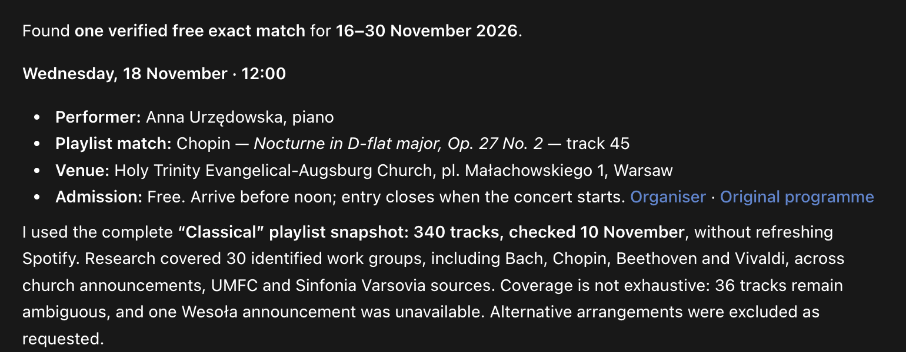

# Hear It Live

**Find live performances of music from your playlist — right in chat.**

Give your assistant a playlist, a place and dates. Get a short list of concerts with the matching works, admission and original programme links. Especially useful for small church recitals that rarely reach the big concert listings.



*Real chat excerpt supplied on 10 November 2026, cropped only. It was captured before file exports were removed; the current skill answers entirely in chat.*

## Try it

[Download the latest skill](https://github.com/skrrrt-and-boom/hear-it-live/releases/latest), or install from source:

```sh
git clone https://github.com/skrrrt-and-boom/hear-it-live.git
cd hear-it-live
python3 install.py --client codex
```

In a new chat, select **Hear It Live** in ChatGPT, invoke `$concert-finder` in Codex, or `/concert-finder` in Claude Code:

```text
Find free concerts in Warsaw from next week to the end of the month
featuring music from this playlist: [Spotify playlist link]
```

For Claude Code, use `python3 install.py --client claude-code`. Updating a managed installation uses `--replace`; removal uses `--uninstall`. ZIP installs can be removed by deleting the extracted skill folder. Python 3.10+ is needed only for the installer and optional existing-playlist reader, not for ordinary chat answers.

## Small on purpose

- **Chat is the interface.** Bold dates and venues, italic work titles, direct sources. No report files, calendars, JSON exports or generated websites.
- **Web research only.** No computer use, scrolling or headless-browser automation. The tool restriction is an instruction, not a change to global app permissions.
- **Actual work matches.** A Bach recital alone is not proof of BWV 565. Movements, arrangements, unknown admission and uncertain leads stay explicit.
- **Only when invoked.** Codex and Claude Code packages preserve explicit-only settings. No background tasks, hosting or extra accounts; your assistant's plan applies.

## Playlist access

Reuse complete data already in the chat, an existing snapshot, or a saved local playlist. The optional reader prints existing data; it never writes files. The snapshot's date is disclosed rather than pretending Spotify was refreshed.

A new Spotify link may expose only a preview through direct fetching. If the full list cannot be verified, the skill explains the gap instead of silently using a subset or opening a browser. [Input details and Spotify conditions](skills/concert-finder/references/inputs.md).

## Contribute

Improve source discovery, work matching or concise chat answers. Keep personal playlists out of the repository. [Contribution guide](CONTRIBUTING.md) · [MIT licence](LICENSE).

```sh
python3 -B -m unittest discover -s tests -v
python3 -B tools/package.py
```
