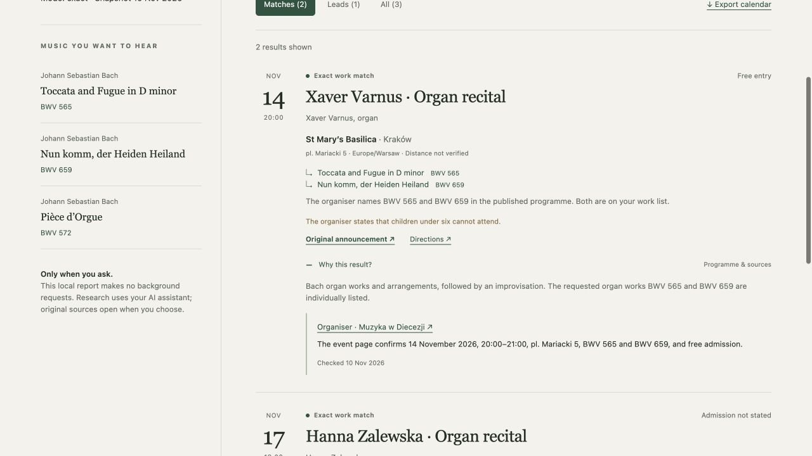

# Hear It Live

**Find the music you love, live — even when the concert is buried on a church website.**

An on-demand skill for Codex and Claude Code that finds classical performances of your chosen works around **any location**. It searches local organisers, parish websites, bulletins and PDFs, then explains each match with original sources.

No hosted service. No account to create. No background activity. MIT licensed.


## Try it

Requires a supported assistant with web search/page access. Python 3.10+ is needed for installation and optional local reports. There are no Python dependencies.

```sh
git clone https://github.com/skrrrt-and-boom/hear-it-live.git
cd hear-it-live
python3 install.py --client codex
```

Start a **fresh chat**, then ask:

```text
$concert-finder Find church concerts near Leiden, within 40 km,
in the next 60 days, performing Bach BWV 565 or BWV 659.
Only exact works; include free and paid concerts.
```

For **Claude Code**, install with `python3 install.py --client claude-code` and invoke `/concert-finder`. [ZIP downloads](https://github.com/skrrrt-and-boom/hear-it-live/releases/latest) and [more examples / removal](docs/TRY-IT.md) are available.

## Why use it?

- **Works, not recording artists.** Catalogue numbers and published programmes matter. “Bach recital” alone is a lead, not a BWV 565 match.
- **Your location.** Discover local sources for the place you choose; no fixed city or venue inventory.
- **Evidence you can inspect.** Original announcements, check dates, unknown prices and missing programmes are visible. Optional local HTML shortlist, directions and calendar export.



## Explicit-only, with no hosting bill

Codex is configured with `allow_implicit_invocation: false`; the Claude Code package uses `disable-model-invocation: true`. Invoke the command when needed. The full instructions and references are not automatically loaded into unrelated tasks; the client may still list the skill's name and description.

Once invoked, its research stays in that chat's history. Use a separate concert-search chat to keep other conversations clear. This is **not** a global memory or a background scraper.

Your assistant supplies the AI and web tools. This project has no server, telemetry, API-key collection or separate OAuth login. Your assistant's subscription, usage charges and tool limits still apply. The local report runs offline; source and directions links open external sites when clicked.

## See it working without an AI account

Open [the saved report](examples/report/index.html) after cloning, or regenerate it:

```sh
python3 skills/concert-finder/scripts/report.py \
  examples/krakow-bach.json --output concert-results
# Open concert-results/index.html in your browser.
```

The screenshots show **real organiser announcements checked on 10 November 2026**: two exact Bach matches in Kraków and a separate lead with unannounced repertoire. The saved report is a dated snapshot, not a live feed. After November 2026 it is an archived example. [Sources and validation](docs/VALIDATION.md).

## Current limits

This is a small first release: an assistant research workflow and local output tools, **not an autonomous crawler or complete concert database**. Coverage depends on accessible sources and the host's tools. The report validates data structure, not musical identity or source truth. Recheck an organiser before travelling.

**Spotify links are not imported in this release.** Supply work names and catalogue numbers yourself. Spotify's current API access and AI-use restrictions mean a general “paste any playlist” importer cannot be assumed. [Input details and official sources](skills/concert-finder/references/inputs.md).

## Contribute

Try a small town, an obscure work, or a programme hidden in a bulletin. Report missed sources and false matches, with public evidence. [Contribution guide](CONTRIBUTING.md) · [MIT licence](LICENSE).

```sh
python3 -m unittest discover -s tests -v
python3 tools/package.py
```
