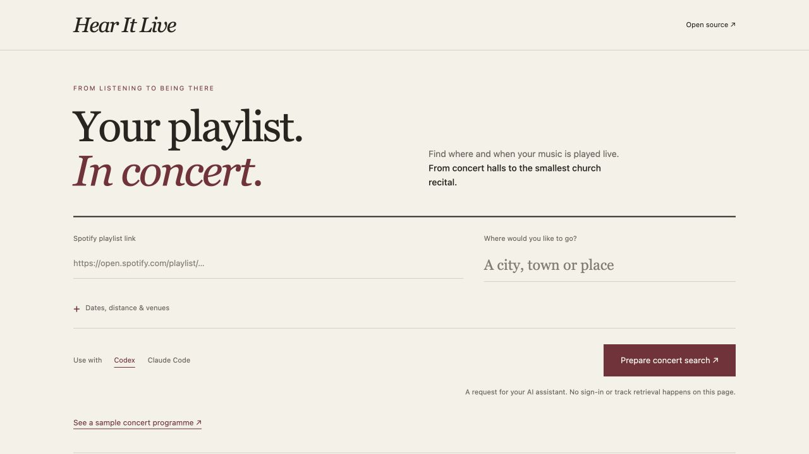
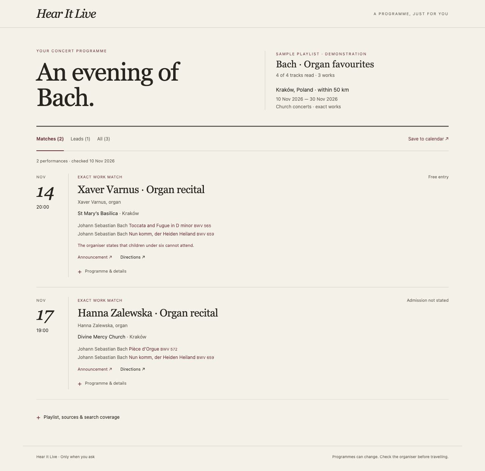

# Hear It Live

**Your playlist. In concert.**

Paste a Spotify playlist link and choose a place. Hear It Live helps your AI assistant find **where and when that music is performed live** — from concert halls to small recitals buried on church websites.

**[Open Hear It Live ↗](https://skrrrt-and-boom.github.io/hear-it-live/)** · [Sample programme](https://skrrrt-and-boom.github.io/hear-it-live/examples/report/) · [Download skills](https://github.com/skrrrt-and-boom/hear-it-live/releases/latest)



## Try it

Install the explicit-only skill for your assistant:

```sh
git clone https://github.com/skrrrt-and-boom/hear-it-live.git
cd hear-it-live
python3 install.py --client codex
```

Start a fresh chat and paste your own playlist link:

```text
$concert-finder Find where and when music from this playlist is
performed near Warsaw, within 50 km, in the next 90 days:
[your Spotify playlist link]
Prioritise church concerts. Include free and paid events.
```

For **Claude Code**, install with `python3 install.py --client claude-code` and invoke `/concert-finder`.

The assistant needs **browser controls and web research tools**. A text-only page fetch can return no tracks. Python 3.10+ is needed for installation and optional local output; there are no Python dependencies. [Installation, examples and removal](docs/TRY-IT.md).

## What happens

1. **Read the whole playlist.** The assistant scrolls the visible public page and verifies every numbered track against its total. A 25-track preview cannot silently become a whole-playlist search.
2. **Identify the works.** Deduplicate recordings, distinguish composers from performers, and keep movements and arrangements accurate. Unresolved tracks stay visible.
3. **Find live performances.** Discover local programmes, parish bulletins and PDFs; match the works against original announcements. Report dates, local times, venues, admission and source links.



The saved demo combines a **synthetic four-track playlist** with **real concert announcements checked on 10 November 2026**. It demonstrates the working report and duplicate-recording handling; it is not a claimed live Spotify import. [Validation and source details](docs/VALIDATION.md).

## Small, free, only when you ask

- Codex: `allow_implicit_invocation: false`. Claude Code: `disable-model-invocation: true`.
- The full workflow loads on invocation; references are read as needed. Research remains in that chat, so use a separate concert-search chat.
- The opening page is a free static request builder. It does **not** fetch Spotify tracks or run an AI service. Copy the request into your own assistant.
- No paid hosting, extra account, API-key collection, telemetry or background listening. Your assistant's plan and usage limits apply. The page and reports also work locally after cloning.

## Access and coverage

Playlist support is an **experimental browser-assisted workflow**, not an official or Spotify-approved integration. A real trial verified all 340 numbered positions of one public playlist. Access can still fail for another playlist, private content or a host without suitable browser tools. The assistant must disclose gaps rather than substitute a preview.

Public visibility is not a policy exemption: Spotify's access and content-use restrictions, including AI-use restrictions, remain relevant. [Input limitations and official sources](skills/concert-finder/references/inputs.md). This release does not provide a Spotify API importer or OAuth flow.

Reading every track does not establish complete concert coverage. The report separately records tracks read, unresolved tracks, works researched and sources checked. Recheck the organiser before travelling.

## Local demo and development

Open `index.html` for the request builder, or generate the saved programme:

```sh
python3 skills/concert-finder/scripts/report.py \
  examples/playlist-concerts.json --output concert-results
# Open concert-results/index.html. No server needed.

python3 -m unittest discover -s tests -v
python3 tools/package.py
```

[Contribute](CONTRIBUTING.md) · [MIT licence](LICENSE)
